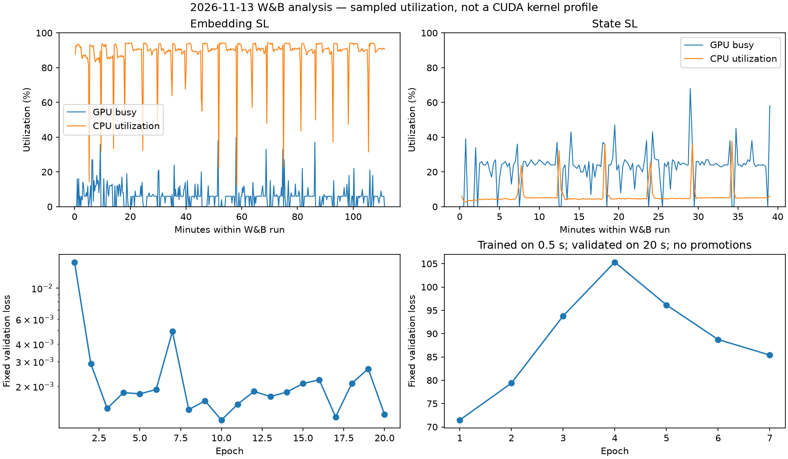

# W&B analysis and resulting changes — 2026-11-13

Read-only exports were downloaded through the configured W&B Public API for
[helpful-paper-17](https://forge.coreweave.com/wandb/ysaxena_personal/hyperdrone-vio-fuel-aware/runs/c3ikypyw)
(embedding SL) and [comic-river-18](https://forge.coreweave.com/wandb/ysaxena_personal/hyperdrone-vio-fuel-aware/runs/yxkxjez9)
(state SL). Raw history/system exports and `analysis.json` are adjacent. No
credentials are included.

For subsequent CUDA profiling, full resource checks, wider embeddings and the
HSSD scene-14 collector repair, see the
[training optimization review](../training_optimization_review.md).



| Observation | Embedding SL | State SL |
|---|---:|---:|
| Completed epochs | 20 | 7 |
| Mean training-loop seconds, including input handling | 317.94 | 293.86 |
| Mean interval between logged epochs, including validation/loading | 336.13 | 315.55 |
| Mean sampled GPU busy | 5.99% | 22.31% |
| GPU busy 95th percentile / maximum sampled | 16% / 40% | 38% / 68% |
| Mean host CPU usage | 88.43% | 6.03% |
| Mean SM-active counter | 2.47% | 2.71% |
| Mean GPU power | 54.97 W | 60.90 W |
| Mean allocated GPU memory fraction | 9.98% | 56.31% |

System samples are approximately 15 seconds apart. They do not show sustained
GPU saturation during either phase, including background collection, but can miss
brief bursts. Memory occupancy is not compute utilization. The process GPU busy
series matches the board series here, so it cannot reliably separate trainer and
collector activity. Initial validation collection precedes these W&B runs and is
not covered by their system streams.

The 28 completed training collections averaged **124.37 seconds** for eight
flights, versus roughly five minutes per training loop. Recorded fresh-data waits
totaled less than a millisecond in each SL phase. Waiting for rendered samples
was not limiting. High host CPU usage, per-image normalization/augmentation, and
repeated GPU-to-CPU priority transfers point to an input/host bottleneck during
embedding SL. State SL's low SM activity and batch one suggest limited batching
and launch overhead. These are inferences, not a CUDA kernel profile.

## Early supervised stopping

Embedding SL reached maximum axis levels by epoch 9, selected epoch 10, then
exhausted eight non-improving cycles at epoch 20. Best joint-embedding loss was
0.0011516; this does not establish VIO trajectory accuracy.

State SL trained **101-sample / 0.5-second windows** throughout. Its window gate
and axis probes judged **4001-sample / 20-second** trajectories. No state axis or
window promoted. Validation loss changed from 71.47 to 85.40 and position RMSE
from 45.15 m to 52.91 m. After six non-improving fresh batches, it stopped at epoch
7; LR had halved at epoch 5. Increasing only the epoch cap would not fix this
short-training/long-gating mismatch.

Old ordering put all 192 ProcTHOR training scenes before HSSD. Batches 0..28 used
only ProcTHOR; HSSD had appeared in validation but not yet in training.

Only two PPO iterations were logged. Launcher status records a **SIGHUP**, not
normal pipeline completion. This termination is distinct from SL early stopping.
Saved checkpoints remain intact.

## Implemented for the next run

- Use fixed **stage-length** probes for promotion and state LR scheduling. Reset
  probe/LR plateau references on horizon changes. Main checkpoint validation and
  global best selection remain unaugmented at 20 seconds.
- Start state SL at **2 → 4 → 8 → 12 → 20 seconds**. Early stopping waits for all
  axes and the longest window, followed by three fresh batches trained at the
  final stage. Ordinary patience begins on the next fresh batch. This replaces
  the initially proposed 24/36-epoch minimums; hard caps and post-promotion grace
  remain. W&B records completion, final-stage cycles and stopping eligibility.
- Allow plateau advancement after six updates only when the current score is
  at most 10% above its stage best. Slight deterioration qualifies; larger
  regressions cannot trigger the fallback, and nonfinite scores are rejected.
- Increase harder-example exposure from 10% to 20%: **60/20/20** current/easy/hard.
  Keep physical IMU-error maxima unchanged.
- Interleave both training catalogs while preserving numeric IDs and held-out scenes.
- Transfer frame RGB as uint8 and batch photometric work on the model device.
  Cap CUDA host Torch threads at two, use two frame workers, increase frame batch
  8 → 32 → 64, and defer learning-progress transfers until epoch end.
  Validation frame batches stay at eight to preserve the joint-embedding loss's
  batch-dependent variance/covariance statistics across this comparison.
- Use state batch at most eight with a 3,208-token budget: **8/4/2/1/1** across
  SL horizons and **8/3/1/1** across PPO horizons; long validation uses batch one.
  This doubles the earlier four-sequence / 1,604-token proposal.
- Raise curriculum frame/state epoch caps to **400/600** and optional distillation
  to **100**, retaining teacher cap **60** and early stopping. The launcher now
  has no automatic wall-clock cutoff; `--seconds` is optional.
- Add W&B curriculum/progress fields, loader-wait timing and collection timing.
  PPO now gets its own W&B run rather than only a local JSONL log. All `train.py`
  phases log the effective loader batch size, sequence length where applicable,
  samples/second and peak CUDA allocation when available.

`input_benchmark.json` measures CPU input preparation on 117 synthetic full-size
pairs at maximum photometric strength: **0.979 s before / 0.045 s after**. This
21.7x ratio was measured for the earlier batch-32 input configuration and excludes
GPU augmentation, the model, rendering and disk I/O. It is
not an end-to-end speedup or accuracy result. New GPU batch settings still need a
real GPU run. The broader regression suite passed **142 tests, 6 skipped**;
the final targeted suite passed **73 tests, 4 skipped**. Coverage includes staged
probe/reference resets, plateau/regression gates, minimum SL exposure, deferred
augmentation equivalence, unchanged native validation, mixed scene coverage,
RGB/embedding SL-to-PPO and PPO-only workflows, and native student/export checks.
CUDA execution was unavailable in the agent environment; GPU throughput and VIO
accuracy improvements have not been measured for the revised preset.

The subsequent completion-aware stopping change passed **74 tests, 2 skipped**
across curriculum, recording reuse and streaming PPO suites. These include RGB
and embedding SL with a slightly worsening probe curve, large-regression holds,
full-axis/longest-window completion, fresh final-stage exposure versus reused
recordings, phase resets and unchanged best-checkpoint selection. The tolerance
remains 10% above stage best.

The larger-batch preset and logging revision passed **120 tests, 4 skipped**
across curriculum, performance, streaming PPO, timed-launcher, training-stage
and embedding suites. This includes fresh/continued preset loading, CLI
precedence, effective SL/PPO batch limits, partial-tail batch reporting, all
training-phase performance records, best-checkpoint preservation and timed
checkpoint mirroring. Configuration-precedence tests parse settings without
executing CUDA kernels; numerical workflow tests use small CPU-capable models.

CUDA was unavailable for this revision. The comparison of old and new batches
over three fresh training batches after warmup, with collection active, remains
pending on the GPU machine. Higher end-to-end throughput, GPU saturation and
validation improvement per hour have not been established for batch 64.

## Collection write optimization for future runs

The active run's [level-6 baseline](collection_baseline.json) recorded eight
flights in **126.20 seconds**: scene builds **15.28 s**, rollouts **29.20 s**,
compression **81.29 s**, and file writes **0.31 s**. Compression consumed about
64% of this batch's elapsed time. Adding more simulator instances would not
address that CPU work.

Future streaming runs and the curriculum preset now use
`COLLECT_COMPRESSION_LEVEL=1`. Recordings remain standard lossless DEFLATE NPZ
files, readable by `np.load(..., allow_pickle=False)`. Camera pixels, IMU,
ground truth, seeds, resolution, flight duration and camera timing are unchanged.
Atomic publication and the pre-write disk cap remain enforced. Faster
compression can produce larger files, reducing flights fitting the same cap;
validation still rejects incomplete held-out coverage.

[collection_io.json](collection_io.json) measures four real-recording prefixes,
two each from ProcTHOR and HSSD, with 32 full-resolution frames per sample and
two repeats per level, alternating execution order. Every array, shape and dtype
matched exactly after loading. Level 1 achieved **5.44× faster write-path time**
and **5.50× faster compression**, with **21.5% larger files** than level 6. These
are bounded CPU NPZ I/O measurements, excluding scene downloads, simulation,
full-flight I/O and training; they do not establish a 5.44× collection speedup.

Collection stats and W&B `pipeline/*` now expose compression seconds, filesystem
write seconds, compression level and recording bytes. New training processes
forward the configured level to the built-in collector. Existing active trainer
processes retain their old command arguments: standalone `collect.py` defaults
to level 6 so this optimization does not silently switch the current run's
compression. Manual collection can opt in with `--compression-level 1`.
Set `COLLECT_COMPRESSION_LEVEL=6` in experiment JSON to restore the old effort
for a future streamed run. Python's [ZIP compression settings](https://docs.python.org/3/library/zipfile.html#zipfile-objects)
and NumPy's [array writer](https://numpy.org/doc/stable/reference/generated/numpy.lib.format.write_array.html)
provide the standard format used here.

Tests cover all supported representative levels (0/1/6/9), exact round trips
including noncontiguous arrays, atomic failure handling, byte-cap boundaries,
invalid settings, collector argument compatibility, older-checkpoint defaults,
scene coverage and timing propagation. Full collection throughput with the new
level and background training still needs a future-run measurement.

Reproduce the bounded benchmark without loading full camera recordings:

```bash
python verification/benchmark_recording_io.py --recordings /path/to/validation --output /tmp/collection-io.json
```

Reproduce from the model folder:

```bash
python verification/analyze_wandb_curriculum.py --plot
python verification/benchmark_frame_input.py
```
